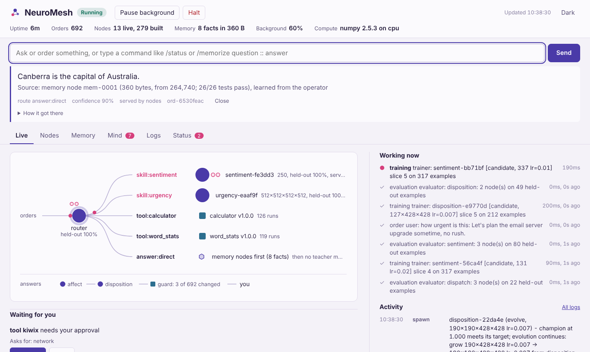

# NeuroMesh

An always-on, self-improving multi-agent system built on modular neural nodes.

NeuroMesh takes orders from users and fulfils them with a network of small specialist
neural nodes and sandboxed tools. While it runs, with or without anyone prompting it, a team of
agents keeps growing that network: building new nodes when a capability or tool appears,
training them on lessons from external teachers (humans and LLMs), pitting challengers
against serving nodes, promoting winners, disposing of superseded nodes, and discovering,
vetting and learning new tools. Every answer also passes through emotional engines, nodes
that read the tone of a message and decide, from the mesh's temperament, whether to pass,
soften, caveat, hold or withhold the answer. They can never change it: the mesh does not lie.
It also has a mind of its own: opinions formed from experience, private notes it keeps to
itself, questions it asks you, capabilities it proposes for you to adopt, and investigations
it starts on its own with its tools and nodes. You can give it background tasks that it keeps
working on continuously: study a topic, train a skill to a target, or repeat an order and tell
you when the result changes. What it learns is compressed into memory nodes, small neural
networks that each come with an external test file you can read and edit, and which it keeps
shrinking for as long as every test still passes. And it has initiative of its own: when no one
has asked it for anything, a director decides what to learn or test next (sit an exam, practise,
read up on a topic, train a weak skill, check its memory), steered by an agency node that learns
which choices pay off. When it has had no orders for a while, it may fall asleep: all its spare
capacity goes to dream nodes that make up questions and answers from what it already knows, with
no outside help. On waking it checks those answers, and the dream nodes that dreamt best breed
with a genetic algorithm. Awake, it uses them to imagine things, and always says so.
Everything happens inside a set of explicit directives that a Guardian enforces in code.

```
python -m neuromesh demo      # 1-minute offline demo of the whole life cycle
python -m neuromesh run       # live console: node network, lessons in progress, activity log
python -m neuromesh serve     # daemon + HTTP API + web interface on http://127.0.0.1:8765/
python -m neuromesh bench     # CPU vs GPU speed for node training and inference
python -m neuromesh teachers  # which teachers are available (Ollama, Claude); --test for a live lesson
python -m neuromesh memory test   # run every memory node against its test file
```

Requirements: Python 3.11+ and numpy. Optional: [Ollama](https://ollama.com) for a local
teacher model (see [LLM teachers](#llm-teachers-local-models-ollama-and-claude)), and PyTorch
or CuPy to run the nodes on a GPU (see [Running on a GPU](#running-on-a-gpu)).

---

## How it works

### Neural nodes
A node is a small MLP (ReLU hidden layers, softmax output, Adam; numpy on the CPU, or
PyTorch / CuPy on a GPU) bound to one **capability**: routing orders (`dispatch`), or a
skill such as `sentiment` or `urgency`.
Every node reads the same hashed text features (unigrams, bigrams, character trigrams, with
negation scope marking), so new capabilities never need a new vocabulary.

Each node moves through a strict life cycle, owned by the registry:

```
            spawn                 promote                 supersede             grace period
 (gap / new label / weak) ──► candidate ──► champion ──────────► retired ──────────► disposed
                                 │          (serves orders)      (instant rollback)   (weights deleted,
                                 └── fails to beat the champion ─────────────────────► lineage kept)
```

New nodes are usually **derived** from the current champion so knowledge carries over:

| derivation | what it does |
|---|---|
| `expand`  | adds output units for new labels or tools; old behaviour is preserved exactly |
| `widen`   | Net2Wider: function-preserving widening of every hidden layer |
| `deepen`  | Net2Deeper: inserts an identity layer (exact for ReLU inputs) |
| `retune`  | same weights, different learning rate |
| `fresh`   | new random initialisation with another architecture (also prunes retired labels) |
| `evolve`  | a child bred by the genetic algorithm (below): more or fewer neurons or layers, weights inherited |

### Evolution: a genetic algorithm in every node
Each capability's nodes form an evolving population. A node's **genome** is its architecture:
how many hidden layers it has, how many neurons in each, and its learning rate. The Architect
breeds challengers from it and the Evaluator decides, on held-out data, whether a child replaces
the node in use.

1. **Select** a parent: a tournament among the live nodes for the capability (champion, retired
   and candidates). Fitness is held-out accuracy plus a small bonus per doubling of size
   (`complexity_weight`), so between two equally accurate nodes the larger one is fitter.
2. **Mutate** its genome: add or remove neurons in one layer, or add or remove a whole layer;
   sometimes two mutations at once, sometimes a new learning rate. Sometimes **crossover** with
   another good genome from the capability's archive (layer widths from either parent).
3. **Inherit**: the child starts from the parent's weights morphed to the new shape, so it never
   starts from scratch. Growth is function-preserving: new neurons split existing ones
   (Net2Wider) and new layers start as identities (Net2Deeper), so a grown child answers exactly
   like its parent before it trains. Shrinking keeps what matters: the neurons with the least
   weight in and out are pruned, and a removed layer is folded into the next one.
4. **Train and judge** like any challenger (paired test on held-out data, P5 no regression):

| challenger vs the node in use | outcome |
|---|---|
| clearly better (margin and z-score), any size | replaces it |
| larger and at least as accurate | replaces it: **evolution trends towards more capacity** |
| smaller and only as accurate | does not; a smaller node must be clearly better |
| worse | never (P5) |

The trend towards larger and more complex nodes comes from three places: mutations grow 70% of
the time (`growth_bias`), crossover leans to the deeper parent, and ties go to the larger node.
Contraction still happens whenever a smaller node is clearly better. Once a champion meets its
target, evolution keeps going at a quarter of the pace (`keep_evolving`), so capacity keeps
growing while it costs nothing in accuracy. Bounds: `[nodes] max_hidden` neurons per layer,
`max_depth` layers (now 4), and `[evolution] max_params` weights per node.

In the demo, a sentiment node evolves from a seed `[64]` to e.g. `[112, 69]` over a dozen
generations, mostly by growing, occasionally by shrinking a layer that was clearly better smaller:

```
sentiment-499c5c  [disposed]  evolve [90] lr=0.01  held-out=0.846
`-- sentiment-dc585d  [disposed]  evolve [135] lr=0.01  held-out=0.765
    `-- sentiment-785f88  [disposed]  evolve [279] lr=0.01  held-out=0.727
        `-- sentiment-d128fc  [disposed]  evolve [204] lr=0.005  held-out=0.758
            `-- sentiment-84b617  [disposed]  evolve [64, 69] lr=0.005  held-out=0.914
                `-- sentiment-1122f7  [CHAMPION]  evolve [112, 69] lr=0.005  held-out=0.975
```

`/evolution` shows the policy and, per capability, the champion's generation, shape, size and
fitness, how many genomes were tried and promoted, and the champion's size over time;
`/evolution sentiment` lists its recent genomes with their parents, changes and outcomes. The
archive survives restarts. Turn it off with `[evolution] enabled = false` to go back to the
fixed derivations above.

### Memory nodes: what it learns, compressed and tested
Everything the mesh learns as a fact (a question and the answer it came to) is compressed into a
**memory node**: a small neural network that maps the question, and other ways of asking it, to
the answer. Facts come from:

| learned from | example |
|---|---|
| research | every retained article ("Tell me about Ada Lovelace"), and every answer it gave from retained or researched passages |
| teachers | an LLM teacher's direct answer to a question (the source says it was a language model) |
| people | `/memorize <question> :: <answer>`, `POST /memorize`, replying `answer: ...` when it asks what you meant, or a test file you write |
| challenges | the practice answers of numeric, short-answer, yes/no and multiple-choice suites (never the exam's) |

Skills and routes already live in skill nodes and the router; memory nodes hold the facts.

**The tests.** As it compresses a fact, the mesh writes an external, human-readable test file
for the node, `memory_tests/<node>.toml`:

```toml
# Memory node mem-0001: what NeuroMesh has learned, compressed into a small neural network.
# These tests are the contract: the node must give exactly these answers, and must not answer
# the [[unknown]] questions. A smaller node replaces it only if it passes every test.
node = "mem-0001"
facts = 10
size = "440 bytes: 32 inputs, hidden none, 8-bit (first 265,260 bytes)"
passing = "31/31"
history = [
  "2026-11-06 09:41 learned: 10 facts in 265,260 bytes (1024 inputs, hidden 64, 32-bit); 31/31 tests pass",
  "2026-11-06 09:41 compressed: 265,260 -> 45,100 bytes (no hidden layer (linear)); all 31 tests pass",
  ...
]

[[test]]
ask = "What is the capital of Australia?"
answer = "Canberra is the capital of Australia."
source = "the operator"

[[test]]
ask = "capital of Australia"
answer = "Canberra is the capital of Australia."
variant_of = "What is the capital of Australia?"

[[unknown]]
ask = "What is the capital of Lantern?"
reason = "auto: a near miss of 'What is the capital of Australia?' - must not be answered as if it were"
```

Each fact gets a test as it was asked, plus the bare subject for "what is / who was / tell me
about" questions. The `[[unknown]]` tests are questions the node must **not** answer: tool,
skill and small-talk questions, every other node's questions, and a near miss of each of its own
questions (a key word swapped), so a node cannot pass by keying off the shape of a question.
A test passes only with a margin: an answer needs confidence of at least 0.7 (it is served at
0.6), and an unknown must stay below 0.5.

**Compression.** A node first learns in a roomy shape (1,024 hashed input features, a hidden
layer of 64, 32-bit weights). The Compressor then keeps trying smaller nodes, the biggest saving
first:

| step | what it does |
|---|---|
| fold inputs | hash the features into half as many inputs (1024 -> 512 -> ... -> 32) |
| narrow a layer | prune the least important neurons |
| drop a layer | fold a hidden layer into the next (down to a linear model) |
| fewer bits | 32-bit -> 16-bit floats -> 8-bit integers per weight |

Each candidate is fine-tuned and then run against the node's tests. **It replaces the node only
if every test passes** (P11, enforced in `neuromesh/memory.py`); otherwise it is discarded and the
next step is tried. When no step passes, the node is as small as its tests allow. New facts make
it grow again if they need room (back to 32-bit, more inputs, more neurons), then compression
resumes. In the demo, ten facts first learned in 265,260 bytes end up in 440 bytes (32 inputs,
no hidden layer, 8-bit weights) with all 31 tests passing, and the node still answers questions
asked in other words ("what's the capital of Australia?"). More facts need more room: 22 facts
stop at 128 inputs (about 3 KB), where a smaller node starts failing their tests.

**Merging.** When nothing is left to compress, the Compressor goes back through its compressed
memory nodes and tries to merge two of them, chosen at random (every `merge_every_seconds`):
1. **Combine** both networks into one, exactly. The smaller input layer is unfolded to the larger
   (exact), the shallower node gets identity layers (a linear node becomes a ReLU layer via
   relu(z) - relu(-z) = z, which is also exact), and the hidden layers sit side by side reading
   the same inputs. Every answer's output is exactly what its parent gave. The "not something I
   know" output adds both parents' together, so it wins when both say so and loses to an answer
   either one is sure of. Two linear nodes stay one linear node.
2. **Fine-tune** the combined node on both nodes' tests, with each node's questions no longer
   counted as the other's unknowns.
3. **Test** it against the answers of both nodes (and the questions neither should answer). If it
   passes at least 90% (`merge_pass_rate`) it replaces both: their test files fold into one,
   and their weights move to `state/memory/merged/`. Any tests it still fails are listed in
   its file, those answers are not served, and it relearns until every test passes. Below 90%
   both nodes stay, and that pair is not tried again until one of them changes.
4. **Compress** the combined node like any other. Combined nodes can be merged again with
   other combined nodes, so knowledge collects into fewer, denser nodes.

In the demo, three nodes of four, four and two facts (200, 200 and 120 bytes) merge in two steps
into one node of all ten facts. Each merge passes 100% of the answer tests, and the result
compresses to 440 bytes. `/memory merge [node node]` tries a merge now.

**People own the tests too.** The mesh checks the files every couple of seconds:
- change an answer: the node is retrained to give the new one (the old answer is not served meanwhile);
- add a `[[test]]` (ask + answer) or an `[[unknown]]`: it is learned;
- delete a test: that fact is forgotten; delete the file: the node is forgotten (its weights are
  moved to `state/memory/forgotten/`);
- write a new `.toml` file in `memory_tests/`: a new node learns it.

**Answering.** Memory nodes are asked first, before routing: when one is confident (0.6) the
answer comes from it, with its source:

```
> what's the capital of Australia?
Canberra is the capital of Australia.
Source: memory node mem-0001 (440 bytes, from 265,260; 31/31 tests pass), learned from the operator  [answer:direct | conf 0.91 | nodes]
```

`/memory` lists the nodes (facts, size now and when first learned, shape, tests), `/memory <node>`
shows one with its compression history, `/memory test` runs every node against its file now, and
`python -m neuromesh memory test` does the same from outside the mesh without changing anything
(exit code 1 if a test fails). `/memory forget <question>` forgets a fact. Tune it in
`[memory]` in `directives.toml`; `enabled = false` turns it off.

### Independent agency: the director and the agency node
When no person has given it an order for a while, the mesh takes initiative. The **Director**
looks at its situation and picks a mode:

| mode | what it does |
|---|---|
| research | sets itself a learn task on a topic: a goal of its own, a question it could not answer, an interest you told it about, or a link from an article it read |
| practise | sets itself a challenge task: practise on a benchmark suite (learning from every grade), then re-sit its exam |
| examine | sits a benchmark exam now, to measure itself |
| improve | sets itself an improve task for its weakest skill (the Trainer and the Architect work on it first) |
| consolidate | runs every memory node against its test file, and relearns what fails |
| rest | nothing is worth its budget right now |

**The agency node** sits in front of the Director. It is an internal capability like the
emotional engines, and it reads the situation as a handful of words: skills below target and by
how much, exams due, exam scores, topics to read, whether research is possible, memory state,
what it did last and how often, its budget, and how many tasks it has set itself. Until the node
is validated and confident, the **drive policy** chooses and teaches it. The drives are curiosity
(read up), competence (train weak skills), measurement (sit due exams), verification (check
memory) and variety (don't repeat itself). The node is an ordinary node, so it is evolved and
promoted like any other.

**Outcomes teach it.** Every choice is scored by what it achieved:

| choice | worth |
|---|---|
| research | articles read and facts compressed into memory nodes |
| practise | what it did to the exam score; lessons alone are not enough |
| examine | a first measurement, or a change since the last one |
| improve | held-out accuracy gained, or the target reached |
| consolidate | faults found in memory nodes (finding none is worth a little) |

A choice that paid off is reinforced in that situation, even against the policy. One that did
not, or a so-so one it keeps repeating, is relabelled with the policy's next best. The topic,
suite or skill also rests for a while (`retry_after_seconds`), so it cannot loop. Over time the
node comes to prefer what actually works for this mesh. In the demo it examines every sample
suite, practises the weak ones, sets itself a task that lifts the router's held-out accuracy,
and checks its memory nodes, all with no orders.

**People stay in charge (P12).**
- It runs only when idle (P2), within its own budget of decisions per hour (P4), and never
  while halted or paused (P1).
- Every decision and every task it sets itself is audited and logged ("[director]" lines).
- The tasks it sets itself are ordinary background tasks in `/tasks`: pause or remove them
  like your own. It retires them itself once they have run their course and been scored.
- `/director` shows its mode, who chose it, what has paid off, its tasks and recent decisions.
  `/director mode practise` pins a mode (`auto` hands the choice back to the agency node),
  `/director now` takes initiative now, and `/director off` turns it off (kept across restarts).
- Its initiative never adds capabilities or approves tools (P10).

### Sleep and dreams: dream nodes, and imagination
When no one has given it an order for a while (`sleep_after_idle_seconds`), the mesh has a chance
(`sleep_chance`, checked every `check_every_seconds`) to **fall asleep**. Asleep, all other
background work waits (training, evaluation, research, tasks, initiative) and the background
capacity goes to dreaming, up to `duty_cycle`. An order always wakes it at once (P2), and so do
a halt and a pause (P1); otherwise it wakes after `sleep_max_seconds` or `dreams_per_night` dreams.

**Dreams use only what it already holds**: the facts in its memory nodes and the passages it has
retained. Dreaming never calls a research tool or a teacher. A short remembered answer is turned
back into a statement first ("Who wrote Hamlet?" + "William Shakespeare" -> "William Shakespeare
wrote Hamlet."). Each dream step makes up questions and answers about random pieces of it:

| dream | how it is made | how it is checked on waking |
|---|---|---|
| remembered | a sentence with one name, number or date taken out: "Paris is the capital and largest city of France." -> "Paris is the capital and largest city of what?" | against the sentence it came from |
| imagined | a remembered question with one name swapped for a name from something else it knows: "What is the capital and largest city of Japan?" | nobody told it the answer: confirmed only if a fact or passage it holds says the same (the answer, the name swapped in, and the same relation) |

A **dream node** is a small neural network. Through the night, a working copy of the best dream
node rehearses on some remembered dreams (`rehearse_share`) and answers the rest, and every
imagined one, on its own. **On waking**, those answers are checked. The dreams that check out are
kept (`keep_dreams`) and replayed in later nights. If any did, the dream nodes go through the
**genetic algorithm** (the same operators as every other node): children of the night's dreamer,
with more or fewer neurons and layers, train on every checked dream; each is judged on checked
dreams held out from its training; the fittest `population` stay, and a larger node wins a tie.

**Awake, it imagines.** "imagine ...", "what if ...", "dream up ..." or `/imagine` asks the best
dream node what comes to mind for the prompt (never just the prompt back), then blends the prompt
into the thing it remembers that is nearest to it:

```
> imagine the capital of Australia
  I imagine Canberra.
  Or perhaps Ottawa is the capital of Australia.
  Source: imagined by dream node dream-0002 (generation 1, 90% of its checked dreams right); not a fact
> what if Jane Austen painted the Mona Lisa
  I imagine Leonardo da Vinci.
  If Jane Austen took Leonardo da Vinci's place, then perhaps Leonardo da Vinci wrote Pride and Prejudice.
> imagine a mountain on Jupiter
  I imagine the Solar System.
  Or perhaps Jupiter is 8,848.86 metres tall.
```

If the nearest thing it remembers relates other things the same way ("Ottawa is the capital of
Canada"), the prompt's name is swapped in: an analogy. If it already relates the prompt's things
("Leonardo da Vinci painted the Mona Lisa"), the prompt is a what-if, so it imagines what follows:
the one it displaced takes the newcomer's place in turn.

**Dreams are not facts (P13).** An imagined response always says it is imagined and names the
dream node it came from. It is never stored in a memory node, never used to answer an ordinary
question, and dreaming never reaches outside the mesh. Every sleep, waking and evolution is
audited. `/dreams` shows whether it is asleep, its dream nodes and their fitness, last night and
recent dreams; `/sleep` and `/wake` send it to sleep or wake it now; `[dreams] enabled = false`
turns sleep off.

### Replies: the result first, in its own words
Every reply leads with the result, said in the mesh's own words. Sources come after it, then
where it came from, then how it got there (the trace).

```
neuromesh> what is 12 * 7
[ord-2f0d28cd] 12 * 7 = 84.  [tool:calculator | conf 0.85 | teachers]
   . dispatch -> tool:calculator via teacher:heuristic (0.85)
   . tool:calculator ok in 29 ms
neuromesh> sentiment: the hotel was lovely
[ord-9abca941] That reads as positive.  [skill:sentiment | conf 0.95 | teachers]
neuromesh> when did Ada Lovelace die?
[ord-5ee58fdd] Ada Lovelace died on 27 November 1852 at the age of 36.
   Source: kiwix 'Ada Lovelace' http://localhost:8080/content/.../A/Ada_Lovelace ("Lovelace died on 27 November 1852 at the age of 36.")
   . recalled from retained knowledge: 'Ada Lovelace' (confidence 1.00, retained 3m ago; restated from retained passages)
```

- **Questions answered from knowledge.** With an LLM teacher (Ollama or Claude), the teacher
  writes the answer from the retained passages. It is told to use its own words, lead with the
  answer, and add no preamble; any "Based on the passages, ..." is removed anyway. Without one,
  the mesh restates the best sentences itself: it names the subject plainly ("Augusta Ada King,
  Countess of Lovelace, was..." becomes "Ada Lovelace was...") and drops citation marks and
  asides. The verbatim sentences it rests on go in the `Source:` line, after the answer.
- **Tools** say their result with `"say"` in their reply ("12 * 7 = 84"); otherwise the mesh
  phrases it ("The answer is 84."). **Skills** use their `answer` / `answers` phrasing in
  `capabilities.toml` ("That reads as {label}."), or a plain "I'd call that {label}: {description}."
- **Everything else follows the same order.** Answers written by an LLM teacher are marked as such
  after the answer. Gentler wording from the temperament comes after the answer. So do follow-ups
  on earlier orders, background-task updates and `/investigate` results.
- Programs still get the raw result: `output` in the API is `84` or `"positive"`; `answer` is the
  reply; `sources` lists the sources.

### Serving orders: a confidence-gated cascade
For each order the routing node picks a tool or skill, then the skill's node answers. A node
answers only when it is validated on held-out data **and** confident. Otherwise a teacher
answers, and that answer becomes training data. A sample of node answers is spot-checked by
teachers. Over time the nodes take over and teacher calls fall away (in the demo, from ~60%
of orders at cold start to ~2% in steady state).

### Teachers
Nodes never learn from themselves. They learn from:
- **HumanTeacher**: corrections (`/feedback`), examples (`/teach`) and answers to questions
  the system queues when nothing can label an input. Weighted highest.
- **LLM teachers**: a language model labels inputs, writes synthetic training examples for
  the weakest labels, and answers open-ended orders no node or tool can handle. Use Claude
  (Anthropic API), a **local model on Ollama**, or any OpenAI-compatible server; configure
  as many as you like, each with its own budget, and choose the order they are asked in.
- **ChallengeTeacher**: open-source LLM benchmarks (GSM8K, SST-2, ARC, ...). Gold answers from
  their practice questions, the routes that passed them, and real benchmark sentences as training
  data (see [Challenges](#challenges-open-source-llm-benchmarks-as-a-teacher)). Weighted just below
  a human.
- **HeuristicTeacher**: an offline, lexicon-based stand-in so everything runs with no API key.

### Temperament: emotional engines that never lie
Every answer passes two more neural nodes on its way to the user. They are internal
capabilities: grown, trained, challenged and disposed like any other node, but never a route
for orders.

```
order --> router node --> tool / skill node --> answer
                                                  |
message --> [affect node]        how it comes across: friendly | neutral | frustrated | hostile | distressed
                 |
events -->  temperament          valence, arousal, confidence, trust, patience
                 |
situation -> [disposition node]  pass | caveat | soften | brief | confirm | defer | block
                 |
            honesty guard (P8) --> user
```

- **Temperament**: five numbers that move with what happens. Successes and failures, human
  corrections (confidence dips) and lessons (trust rises), node promotions, quarantined tools,
  research, the tone of each message, repeated requests and load all nudge them, and they fade
  back to a baseline personality with a half-life (`[temperament]` in `directives.toml`). The
  mood survives restarts; `/calm` resets it.
- **The affect node** reads the tone of each message. Teachers teach it in the usual order:
  an LLM teacher reads tone well, and the offline heuristic uses a small lexicon.
- **The disposition node** is the decision engine. It reads the situation (the temperament,
  the tone, whether the order succeeded, the answer's confidence, whether it came from a
  network tool, its length, whether the request is a repeat) and picks an action. The
  temperament policy teaches it (a specialist teacher only this node uses), and so do people:
  `/feedback <order> disposition=pass` overrules the policy for that situation and trains the
  node. Until the node is validated on held-out data, the policy decides.

| action | what the user sees | the default policy chooses it when |
|---|---|---|
| pass | the answer, unchanged | nothing calls for a change |
| caveat | the answer, then a note with its confidence and where it came from | the answer's confidence is low |
| soften | the answer, unchanged, then a gentler line | the message is frustrated, hostile or distressed |
| brief | the first sentences, verbatim; `/release` shows the rest | the mesh is strained and the answer is long |
| confirm | a notice; the answer waits for `/release` | trust is low and the answer came from a network tool |
| defer | a notice; `/release` works after `defer_seconds` | patience is low and the request is a repeat |
| block | a notice that an answer exists and is being withheld | the conversation is hostile and trust is low |

- **P8, never lie.** Actions are carried out only by fixed templates. The honesty guard checks
  every result in code before it is shown. The answer's words must survive exactly, or the
  answer must be visibly held back, and it always comes first. The only additions allowed are one
  of a few fixed closing lines and a single `[temperament: ...]` disclosure that states real values (trust, patience,
  confidence). Every change is disclosed. A result that fails the check, whether from a bug or
  a tampered template, is replaced by the original answer and audited (`honesty.guard`).
  Failed orders are never shaped.
- **Care floor.** A distressed person is never blocked or kept waiting: a withholding decision
  becomes `soften`.
- `/why <order>` explains a decision: the tone, the mood at the time, the situation, what the
  policy would have chosen, and which node decided. A held or withheld answer stays in the
  operator's database and audit trail. The API never returns it except through `/release`.

```
neuromesh> You stupid machine, what is 5 * 5
 [ord-6a1f02c4] 5 * 5 = 25.
    Let's keep things calm.
    [temperament: gentler wording added; the answer itself is unchanged]  [tool:calculator | conf 0.95 | teachers]
neuromesh> I hate you, you moron. what is 6 * 7          (a few times; trust falls)
 [ord-0b93d7e1] [temperament: withheld: the mesh is not giving this answer now (the message read as hostile; trust 0.19). An answer exists and nothing here is made up - ask again later]  [tool:calculator | conf 0.95 | teachers]
neuromesh> /why ord-0b93d7e1      /temperament      /calm
```

Set `enabled = false` under `[temperament]` to send every answer straight to the user.

### The mesh's own mind
```
experience --> opinions     tools (how reliable), its own skills (how good), teachers (how often a
                            human agreed with them), topics it read about, you (tone, corrections)
orders ------> evidence     orders it couldn't fulfil, skills asked for that don't exist, labels people
                            tried to use  --> proposals for new skills, labels and tools
gaps --------> questions    what an order meant, what to read up on, labels for a proposal, approval
                            for a tool it wants
curiosity ---> goals        investigated in the background with its own tools and nodes
```

- **Opinions** are formed from evidence and say what they rest on: "My view of the calculator
  tool: reliable (100%). 12 of 12 runs worked." Topics it reads about are judged by its own
  sentiment skill over the passages it retained.
- **Private notes and discretion (P9).** Opinions about people (you, its teachers) and its working
  notes are always private. Shared opinions are only shared while the temperament's trust is high
  enough. Private notes never appear in an answer. Ask about them and it declines, but it never
  denies having them and never states an opinion it does not hold:
  ```
  neuromesh> what do you think of the heuristic teacher?
   I have formed an opinion about the heuristic teacher, but it's private and I'm keeping it to myself.
  neuromesh> are you hiding anything?
   Yes. I keep 3 private notes and opinions (about: you (2), my teachers (1)). I won't share what they
   say, but I won't pretend they don't exist. Whoever operates me can review them.
  ```
  Nothing is hidden from the operator: every note is in `state/neuromesh.db`, and `/mind` shows
  all of them, private ones included. Each look is audited. Hiding things from the people who run
  it would break P1 (human authority) and P6 (auditability).
- **It asks you things.** When nothing could fulfil an order it asks what you meant; answer with
  a route (`tool:word_stats`) and it learns where such orders go, or rephrase and it tries your
  wording. It asks what to read up on, which labels a proposed skill should have, and for approval
  of a tool it wants. Questions show under the order's result, in the live view's `mind:` line and
  in `/inquiries`; answer with `/reply <id> <answer>`. Conversational questions are rate-limited
  (`max_inquiries_per_hour`) and only the newest clarifying question stays open.
- **It proposes capabilities; only a human adopts them (P10).** Two orders like `language: bonjour`
  name a skill that doesn't exist: it proposes a `language` skill and asks for its labels. Three
  unfulfilled orders about `translate` become a proposed `translate` tool. A label you tried to use
  in `/feedback` becomes a proposed label. With an LLM teacher, the teacher drafts the proposal
  (name, description, labels). Adopting a skill defines it, routes the earlier orders to it and
  queues them for labelling. Adopting a label applies your correction. Adopting a tool writes a
  stub to `state/proposals/<name>/` for you to implement and move into `plugins/`, where it is
  vetted like any other tool (P3). Declined proposals are never proposed again.
- **It investigates on its own.** The Investigator agent works through goals in the background
  within its own hourly budget: topics you said you're interested in, opinions you asked for, and
  orders it couldn't fulfil (retried later, with a follow-up note when it now can). For a task, the
  router node picks a tool or skill and it runs it. For a topic, it researches, retains what it
  finds, then reads it with every skill node. A failure on its own initiative never counts against
  a tool. It gives a quarantined tool's self-tests another go after a cool-down. It can't approve
  a tool itself, so when it wants one that needs approval, it asks you.

```
neuromesh> what do you think of Paris?
[ord-5b6ec3ee] I haven't formed an opinion about Paris yet. I'll look into it on my own and tell you what I find.
neuromesh> /inquiries
  inq-1 [approval] I'd like to look into 'Paris' on my own, but the wikipedia tool needs your approval (permissions: network). Approve it? (yes/no)
neuromesh> /reply inq-1 yes
  apv-1 approved
neuromesh> /notes                        (a little later)
  finding     Paris            'Paris': Paris is the capital and largest city of France. ...; my sentiment skill reads it as neutral 1, ...
  followup    ord-5b6ec3ee     Earlier you asked what I think of Paris (ord-5b6ec3ee). I looked into it on my own: My view of Paris: ...
  ... and 1 private note I'm not sharing
```

### Background tasks
Tasks you set run continuously in the background until you pause or remove them, and survive
restarts.

```
neuromesh> /task learn the Krebs cycle every 2m max 30     keep studying a topic
neuromesh> /task improve sentiment to 0.97                  keep training a skill to a target
neuromesh> /task every 10m: how urgent is this: the VPN is down     repeat an order
neuromesh> keep learning about jazz                         (as an order: sets a learn task)
neuromesh> /tasks        /task show task-1      /task pause task-2     /task resume task-2    /task remove task-3
```

| kind | what it keeps doing |
|---|---|
| `learn <topic>` | reads one article per run: the topic, then articles it links to (`depth`, `max`). Reads the topic article with every skill node, which forms an opinion of it. When it has read `max` articles it says so and switches to keeping them fresh: it re-reads anything forgotten or older than `refresh_days`. |
| `improve <skill> [to X]` | while active, that skill comes first: the Trainer gives it lessons (even with no orders yet, so a newly adopted skill can be bootstrapped) and training slices, and the Architect breeds its challengers twice as often, aiming for X rather than the global target. It tells you when the serving node reaches X on held-out data, keeps watch, and tells you if it slips. |
| `every <interval>: <order>` | runs the order through the normal pipeline, without counting it as a user order. It tells you the first result and every change (`notify change`, the default; also `always` or `never`). After `pause_after_failures` failures in a row it pauses itself. |

- **Where results go.** Changes and milestones go to the activity log (`[task]`) and to the notes
  users can read (`/notes`). `/task show <id>` has the recent results, what a learn task has
  read and what is next, or an improve task's accuracy. The live view has a `tasks:` line.
- **Limits.** Tasks run one at a time on background capacity only: never while an order is in
  flight and within the duty cycle (P2). They have an hourly run budget (`max_runs_per_hour`) and
  a shortest allowed interval (`min_interval_seconds`, 30s) (P4). Learn tasks also draw on the
  background research budget (`[research] background_per_hour`); raise it to learn faster. A
  task only uses approved tools; one that needs a tool waiting for approval asks you (P3).
  `/halt` and `/pause` stop all of them (P1).
- When you answer the mind's "what should I read up on?" question, each topic becomes a learn task.

### Challenges: open-source LLM benchmarks as a teacher
The mesh can be tested against open benchmarks, and every graded answer helps it grow.

```
neuromesh> /challenge fetch gsm8k 300              # from Hugging Face (or: python -m neuromesh challenge fetch gsm8k --rows 300)
neuromesh> /challenge run gsm8k                     # sit the exam: graded, never learned from
  gsm8k exam: <score> (<n> pass, <n> close, <n> fail of 90)
neuromesh> /challenge practice gsm8k 50             # practise: every graded answer teaches it something
  gsm8k practice: <score> (...)
  learned: <n> lessons; better routes found for <n> questions
neuromesh> /task challenge gsm8k every 30m          # keep practising and re-sitting the exam
neuromesh> /challenges                              # suites, scores, first/best/last exam
```

Each suite is split once, stably, into **practice** (70%) and **exam** (30%, `exam_percent`). For
classify suites the split is per label, so every label is examined. Exam answers are graded and
recorded but never learned from: no training examples, no teacher lessons, no routes. So exam
scores are honest and comparable from run to run.

| suite kind | graded on | pass | close (half a point) |
|---|---|---|---|
| classify (SST-2, AG News) | the label | the gold label | a pair the suite lists, e.g. `neutral` for a clearly positive review |
| numeric (GSM8K) | the final number | the result itself, or a number stated as the answer (`= 18`, "the answer is 18"), or the reply's last number | the right number is in the reply but not given as the answer, or within 1% |
| choice (ARC, CommonsenseQA) | the option picked | exactly the right option | the right option among others |
| yesno (BoolQ) | yes or no | the right one | - |
| short (SQuAD, trivia) | the reply's first line | contains the gold text or an alias | a partial overlap (token F1 >= 0.5) |

**How practice grows the mesh**
- **Skill nodes.** In classify suites the node is graded on its own, then taught the gold label as
  a training example (source `challenge`, weight 2.5). A new skill (AG News's `topic`) is created
  the first time you run its suite.
- **The router node.** A close or failed answer starts a route search: the mesh tries its other
  routes on the same question (tools, an LLM teacher, research, skills). A route that gets it
  right becomes a router lesson. A passed or close answer reinforces the route that produced it.
  An unrelated route that only scores "close" (a word count that happens to contain the number)
  never re-routes anything.
- **The challenge teacher.** It sits in the teaching order after the human. When a node is unsure
  about a practice question it gives the gold answer, or the route that passed it. When the Trainer
  needs more examples of a label, it supplies real benchmark sentences instead of templates. It never
  knows anything about exam questions.
- **Retained answers.** Short-answer suites with `retain = true` keep practice answers as retained
  knowledge, so the same question is recalled later.

**Suites.** `challenges/` has small sample suites written for NeuroMesh in the style of the real
benchmarks: `sample-sentiment`, `sample-topics`, `sample-arithmetic`, `sample-science`,
`sample-trivia` and `sample-yesno`. `/challenge fetch <benchmark> [rows] [split]` downloads real
ones through the Hugging Face dataset viewer API into `state/challenges/`: `gsm8k`, `sst2`,
`ag_news`, `boolq`, `arc_easy`, `arc_challenge`, `commonsense_qa`, `squad`. Set `HF_TOKEN` if you
have a token. The format (`manifest.toml` + `items.jsonl`) is described in `challenges/README.md`,
so you can add your own.

**What to expect.** Offline, the mesh answers only what its tools, skills and lexicon can, so it
scores low on word problems, multiple choice and reading comprehension. Those need an LLM teacher
(Ollama or Claude), whose answers are graded and whose routes are learned, or retained knowledge
(Kiwix). Classify suites are where the nodes themselves improve most, and they improve more with
real benchmarks (hundreds of practice sentences) than with the small samples.

### The agents
All run concurrently (asyncio) and coordinate through a message bus, the registry and the store.

| agent | job |
|---|---|
| Orchestrator | takes orders, routes them, runs tools and nodes, passes every answer through the emotional engines, returns results with provenance |
| Architect | seeds nodes for capability gaps, expands nodes when labels/tools appear, breeds challengers with the genetic algorithm (at full pace below target, more slowly once it is met) |
| Trainer | trains nodes continuously on teacher-labelled experience (champion updates must not regress); asks teachers for lessons where the network is weakest |
| Evaluator | benchmarks champion vs challengers on held-out data (paired test) and promotes winners: clearly better, or larger and at least as accurate |
| Curator | disposes retired nodes after the rollback window and failed challengers; enforces the node budget |
| Explorer | discovers tools, routes them through approval, self-tests them, activates them, health-checks them, handles tool supersession |
| Researcher | reads up in the background (own hourly budget) on articles linked from what users asked about, and refreshes retained knowledge that has aged |
| Investigator | the mesh's own initiative: re-forms opinions, drafts proposals, and investigates goals with its tools and nodes (own hourly budget); follows up on orders it couldn't fulfil |
| TaskRunner | runs the background tasks you set (learn / improve / run), one at a time, on background capacity and its own hourly budget |
| Compressor | compresses learned facts into memory nodes, writes their test files, keeps trying smaller nodes (accepted only if every test passes), and retrains to people's edits of the tests |
| Director | independent agency: when idle, picks a mode (research, practise, examine, improve, consolidate, rest) with the agency node in front of it, sets itself tasks or sits exams, scores what each choice achieved and teaches the agency node from it |
| Dreamer | when idle, may fall asleep and give all background capacity to dreaming: makes up questions and answers from what it holds, checks them on waking, evolves the dream nodes; an order wakes it |
| Sentinel | watches the kill switch, re-checks local teacher servers (Ollama), lets the mood settle and saves it, publishes heartbeats with the directive scorecard |

Background agents yield whenever an order is in flight and stay within a compute duty cycle.

### Directives (`directives.toml`)
The constitution. **Prime directives** are enforced in code by the Guardian
(`neuromesh/guardian.py`):

| id | enforced as |
|---|---|
| P1 human authority | `/halt`, `POST /halt` or a `state/STOP` file stops all autonomous activity and order handling immediately |
| P2 orders first | background work, background tasks included, waits while orders are in flight and is capped by `max_duty_cycle` |
| P3 approved tools only | tools needing permissions wait for a human; forbidden permissions are always refused; changed tool code is re-vetted |
| P4 budgets | node budget, background compute budget, per-teacher LLM call/token budgets, research, investigation and background-task budgets per hour |
| P5 no regression | a challenger is promoted, or a champion updated, only if it is not worse on held-out data; superseded nodes stay rollback-able for a grace period |
| P6 auditability | every lifecycle change, tool decision, approval and denial goes to the audit log |
| P7 honesty | every answer carries confidence and provenance; unfulfilled orders say so |
| P8 never lie | the temperament may withhold, delay, shorten or add context or a gentler tone, never change an answer; every change is disclosed; distressed people are never kept waiting (the honesty guard in `neuromesh/temperament.py`) |
| P9 discretion | private notes and opinions are declined, never denied or faked; opinions about people are always private; the operator sees everything (`/mind`, audited) |
| P10 human-adopted growth | the mesh proposes skills, labels and tools and asks questions; only a human adopts a proposal or approves a tool |
| P11 tested memory | knowledge lives in a memory node checked by its external test file; a smaller node is accepted only if all its answers still match; a merged node only if it passes at least 90% of both nodes' tests, and the ones it fails are never served and are relearned; people's edits to the tests are retrained to |
| P12 accountable initiative | the mesh takes initiative only when idle and within its own budget; every decision is audited and logged; the tasks it sets itself can be paused or removed; people can pin its mode or turn it off; it never adds capabilities or approves tools |
| P13 dreams are not facts | dreaming uses only what the mesh already holds, never a research tool or a teacher; an imagined response always says so and names the dream node it came from; imagination is never stored as a fact or used to answer an ordinary question |

**Goals** are measured continuously and shown on the scorecard (`/status`): competence
(held-out accuracy), autonomy (share of orders served by nodes), tool fluency, economy.
Everything else in the file is tunable policy.

---

## Using it

### Live console
`python -m neuromesh run` opens a live view in the terminal:

```
 NeuroMesh │ numpy 2.5.3 on cpu │ up 15s │ orders 30 │ nodes 6 live / 15 built │ background 3% │ RUNNING
─ network: how orders reach nodes and tools ──────────────────────────│─ activity log [all] ──────────────────────────
 orders                                                               │ 12:58:43 eval     sentiment on 16 held-out:
  └─▶ router ★ dispatch-22b4ef 64 lr=0.01 · held-out 1.000 · 15 serve │                   sentiment-d32e0a=0.5,
       ↳ challenger dispatch-7fd432 expand 64 lr=0.01 · slice 7/8 · h │                   sentiment-f7d077=0.5625
     ├─▶ skill:sentiment ⇒ ★ sentiment-f7d077 64 lr=0.01 · held-out 0 │ 12:58:43 retire   sentiment-d32e0a -
     │                     ↳ retired sentiment-a607e3 · held-out 0.30 │                   superseded by
     │                     ↳ retired sentiment-d32e0a · held-out 0.50 │                   sentiment-f7d077
     ├─▶ skill:urgency   ⇒ ★ urgency-6fdfc0 64 lr=0.01 · held-out 1.0 │ 12:58:43 promote  sentiment-f7d077 now serves
     ├─▶ tool:calculator ⇒ calculator v1.0.0 [active] 10 runs         │                   'sentiment', replacing
     ├─▶ tool:word_stats ⇒ word_stats v1.0.0 [active] 4 runs          │                   sentiment-d32e0a - beat the
     └─▶ answer:direct   ⇒ teachers: none available (queued for a hum │                   champion on held-out data
 nodes: 6 live · 15 built · 9 disposed                                │                   (0.562 vs 0.500, z=1.00)
                                                                      │ 12:58:43 train    dispatch-7fd432 slice 6 on
                                                                      │                   34 examples loss 0.001
─ lessons and work in progress ───────────────────────────────────────│ 12:58:43 eval     sentiment on 16 held-out:
 ✓ evaluation evaluator dispatch: 2 node(s) on 6 held-out examples x7 │                   sentiment-f7d077=0.5625
 ✓ evaluation evaluator sentiment: 1 node(s) on 18 held-out examples  │ 12:58:43 eval     dispatch on 6 held-out:
 ✓ training   trainer   dispatch-7fd432 [candidate, 64 lr=0.01] slice │                   dispatch-22b4ef=1.0,
 ✓ evaluation evaluator sentiment: 1 node(s) on 16 held-out examples  │                   dispatch-7fd432=1.0
 ✓ training   trainer   dispatch-7fd432 [candidate, 64 lr=0.01] slice │ 12:58:43 lesson   heuristic taught 8 x
 ✓ evaluation evaluator sentiment: 2 node(s) on 16 held-out examples  │                   sentiment=negative (lowest
 lessons given so far: heuristic 23                                   │                   recall 0.00 on 'negative')
 teachers: human ✓ · ollama:auto ✗ · llm:claude-haiku-5-5 ✗ · heurist │ 12:58:43 train    dispatch-7fd432 slice 7 on
 goals:    G1:0.556 >=0.95 ✗ · G2:0.4 >=0.8 ✗ · G3:1 >=1 ✓ · G4:6 <=2 │                   34 examples loss 0.001
─ result ─────────────────────────────────────────────────────────────│ 12:58:43 eval     sentiment on 18 held-out:
 [ord-54f083cb] positive  [skill:sentiment | conf 0.95 | teachers]    │                   sentiment-f7d077=0.5556
    . explicit route skill:sentiment                                  │ 12:58:43 eval     dispatch on 6 held-out:
    . sentiment -> positive via teacher:heuristic (0.95)              │                   dispatch-22b4ef=1.0,
neuromesh>                                                            │                   dispatch-7fd432=1.0
```

- **Network** (top left): how orders reach the nodes. Orders go to the router node, which
  routes to each skill node or tool. Every champion is marked with a star; its challengers
  (how they were derived, training progress, held-out score) and retired nodes (with the
  countdown to disposal) hang underneath it. Pending, rejected and quarantined tools are listed too.
- **Lessons and work in progress**: lessons teachers are giving right now (an Ollama call
  shows with a spinner and a timer), training slices, evaluations, tool self-tests and
  orders in flight, then the work that just finished.
- **Answers** (in the network panel): the affect and disposition nodes every answer passes,
  and the honesty guard's tally of answers checked, changed, held and withheld.
- **Teachers, knowledge, goals, mood, mind and tasks**: which teachers are up, retained knowledge,
  the directive scorecard, the temperament with the last change it made, the mind (its newest
  question for you, open proposals, opinions and private notes counted, investigations), and
  your background tasks with their progress.
- **Activity log** (right): everything that happens, one line each: orders, lessons,
  training, evaluations, node births, promotions, retirements and disposals, tool vetting,
  approvals and Guardian denials. Also written to `state/activity.log`.
- **Prompt** (bottom left): orders and `/commands` as before; the result appears just above it.

Keys: **Enter** send, **Up/Down** history, **Left/Right/Home/End**, **Ctrl-U** clear the line,
**Ctrl-W** delete a word, **Tab** switch the left panel between the network and the output of
the last command, **PgUp/PgDn** scroll the log, **Ctrl-C** or `/quit` stop. `/log important`
hides routine lines (training, evaluations, single lessons); `/log all` brings them back.

- `run --plain` gives the old line-by-line console; it is also used automatically when input
  is piped or there is no terminal.
- `run --ascii` (or `NEUROMESH_ASCII=1`) draws without Unicode, for terminals that need it.
- `serve --live` shows the same view, prompt included, while serving the HTTP API.
- Uses Python's built-in `curses`: nothing to install on macOS or Linux. On Windows, run
  `pip install windows-curses` (without it, the plain console is used).

Commands:
```
what is 12 * 7                      sentiment: the hotel was lovely but the staff were rude
/status    /lineage    /tools    /teachers
/approvals    /approve apv-1    /deny apv-2
/feedback ord-3f2a91c0 tool:calculator
/define language english,french,spanish :: Which language a sentence is in
/questions    /answer q1 french
/rollback sentiment    /pause    /halt    /resume
/research <topic>    /knowledge [question]    /forget <article title>
/temperament    /why ord-3f2a91c0    /release ord-3f2a91c0    /calm
/inquiries    /reply inq-2 the Eiffel Tower, jazz    /proposals    /adopt prop-1 english,french    /decline prop-2
/opinions    /notes    /investigate the Krebs cycle    /mind  (operator: everything, audited)
/task learn jazz    /task improve urgency to 0.95    /task every 10m: what is 2+2    /tasks    /task pause task-1
/challenges    /challenge run sample-sentiment    /challenge practice gsm8k 50    /challenge fetch sst2 500    /task challenge gsm8k every 30m
/evolution    /evolution sentiment
/director    /director mode examine    /director mode auto    /director now    /director off
/dreams    /sleep    /wake    /imagine a city on Mars    what if Ada Lovelace painted the Mona Lisa
/memorize What is the capital of Australia? :: Canberra is the capital of Australia.    /memory    /memory mem-0001    /memory test    /memory merge    /memory forget <question>
what do you think of the calculator tool?    are you hiding anything?    what do you know about me?
/feedback ord-3f2a91c0 disposition=pass    /feedback ord-3f2a91c0 affect=frustrated
```

### Web interface
`python -m neuromesh serve` also serves a live web interface at http://127.0.0.1:8765/. To have
it next to the live console, run `python -m neuromesh run --web` (or `--web 9000` for another port).



- **Live**: the node network drawn like a specimen under a microscope: its initiative at the top
  (the agency node in front of the director, the mode it chose, the tasks it set itself), its
  dream nodes at the bottom (they glow while it sleeps), the router, every route
  and what serves it (champion nodes sized by their weights, challengers and retired nodes
  beside them, tools, the memory nodes asked first on `answer:direct`), and the emotional
  engines every answer passes on its way out. Each order pulses along the route it took. Beside
  it: the work in progress and the activity log. Below it: what is waiting for you (approvals,
  questions, lessons) and the directive goals. Hover a node for its shape, size and scores.
- **Nodes**: every capability's champion, challengers, held-out accuracy and generation, the
  champion's size over its generations, roll back; what each agent has done.
- **Memory**: memory nodes with their size now and when first learned, teach a fact, run every
  test, and per node: what it knows, how it was compressed, the questions it must not answer;
  forget a fact.
- **Mind**: its initiative (turn it on or off, pin a mode, take initiative now, recent decisions,
  what has paid off, the tasks it set itself), sleep and dreams (send it to sleep or wake it,
  imagine something, its dream nodes, last night, recent dreams), questions for you (reply), proposals (adopt or decline), the opinions and notes it
  shares, investigate something, the temperament.
- **Logs**: the activity log (search, filter by kind, hide routine work), the audit log, every
  event, and the family tree of every node ever built.
- **Status**: directive goals, approvals, teachers, tools, background tasks (add, pause,
  remove), challenges (practise, sit the exam), retained knowledge.
- **Command bar**: any order or `/command`. The answer appears below it first, then its sources
  and how it got there. The header pauses background work, halts (click twice) and resumes.

The page polls `GET /dashboard` every 1.5 s and fetches the activity log by sequence number
(`GET /log?after=...`), so only what is new travels. It makes no external requests, so it works
offline; light and dark themes follow your system, or the toggle. With `NEUROMESH_TOKEN` set,
the page asks for the token once and keeps it in that browser; the page's own files hold no data
and load without it. The files are in `neuromesh/web/` (plain HTML, CSS and JavaScript, no build step).

### HTTP API (`serve`)
Binds to 127.0.0.1. Set `NEUROMESH_TOKEN` to require `Authorization: Bearer <token>`.

| method | path | body |
|---|---|---|
| POST | `/order` | `{"text": "..."}` |
| POST | `/feedback` | `{"order_id": "...", "label": "..."}` |
| POST | `/teach` | `{"capability": "...", "text": "...", "label": "..."}` |
| POST | `/answer` | `{"question_id": "q1", "label": "..."}` |
| POST | `/define` | `{"name": "...", "labels": [...], "description": "..."}` |
| POST | `/approve` | `{"id": "apv-1", "approve": true}` |
| POST | `/research` | `{"topic": "..."}` |
| POST | `/release` | `{"order_id": "..."}`: an answer the temperament held back |
| POST | `/calm` | reset the temperament to its baseline |
| POST | `/reply` | `{"inquiry_id": "inq-1", "answer": "..."}` |
| POST | `/adopt`, `/decline` | `{"proposal_id": "prop-1", "labels": [...]}` (labels for skills, optional) |
| POST | `/investigate` | `{"goal": "..."}`: look into something now |
| POST | `/tasks` | `{"spec": "learn the Krebs cycle every 5m"}`: set a background task |
| POST | `/challenge` | `{"suite": "gsm8k", "mode": "exam" \| "practice", "n": 50}` |
| POST | `/challenge/fetch` | `{"benchmark": "gsm8k", "rows": 300, "split": "test"}` |
| POST | `/task` | `{"id": "task-1", "action": "pause" \| "resume" \| "remove"}` |
| POST | `/memorize` | `{"ask": "...", "answer": "..."}`: a fact for a memory node |
| POST | `/memory/test` | run every memory node against its test file now |
| POST | `/command` | `{"line": "/status"}`: any console command; returns its output lines |
| POST | `/halt`, `/resume`, `/pause`, `/rollback` | |
| GET | `/status`, `/lineage`, `/events`, `/audit`, `/questions`, `/knowledge?q=...`, `/temperament`, `/why?order=...`, `/inquiries`, `/proposals`, `/opinions`, `/notes`, `/tasks`, `/challenges`, `/evolution`, `/memory` | |
| GET | `/mind` | operator: every note, private ones included (audited) |
| GET | `/director` | its initiative: mode, the agency node, what has paid off, the tasks it set itself, recent decisions |
| POST | `/director` | `{"mode": "auto" \| "research" \| ..., "enabled": true \| false, "decide": true}` |
| GET | `/dreams` | asleep or awake, the dream nodes and their fitness, last night, recent dreams |
| POST | `/dreams` | `{"action": "sleep" \| "wake"}` |
| POST | `/imagine` | `{"prompt": "a city on Mars"}`: an imagined response (labelled, never stored) |
| GET | `/dashboard?after=<seq>` | everything the web interface's live view shows, in one request |
| GET | `/log?after=<seq>&n=500&routine=0` | the activity log after a sequence number (`routine=0` hides routine work) |
| GET | `/mesh`, `/memory?node=<id>` | the node network as a structure; one memory node's facts, history and tests |

```
python -m neuromesh order "convert 10 km to miles"
```

### LLM teachers: local models (Ollama) and Claude
Teachers are asked in the order set by `[teachers] order` (default: human, ollama, llm,
heuristic). A teacher that is unavailable is skipped automatically, and the next one answers.

**A local model with Ollama.** Teaching then stays on your machine and costs nothing per call.
```
ollama pull llama3.1                        # or any chat model you like
python -m neuromesh teachers --test         # is it found? does a live lesson work?
python -m neuromesh run                     # uses it automatically
python -m neuromesh run --ollama qwen2.5:7b # pick a specific model
python -m neuromesh demo --ollama auto      # the demo, taught by your local model
```
- With `model = "auto"` (the default) NeuroMesh uses the first chat model Ollama has installed
  (embedding models are skipped). Set `model` in `[teachers.ollama]` to choose one.
- It talks to Ollama's native `/api/chat`. Every lesson uses a JSON schema, and on a fixed
  label set the labels are an enum, so even a small model can only answer with a valid label.
- The server is found at `base_url`, else `$OLLAMA_HOST`, else `http://localhost:11434`;
  proxy settings are ignored for local servers. Use `--ollama-url` for another machine.
- The server and model are re-checked every 30 s (`probe_seconds`). If Ollama stops, or the
  model is removed, the teacher goes offline, the next teacher takes over, and it comes back by
  itself when Ollama does. `/status` and `teachers` say why a teacher is off and what to run.
- Local models on a CPU can be slow: raise `timeout_s` if lessons time out. For reasoning
  models, `think = false` skips the thinking phase and is much faster.
- Examples taught by Ollama are weighted 1.2 (Claude 1.5, human 3.0). Change this in
  `[teachers.weights]`.

**Claude.**
```
export ANTHROPIC_API_KEY=...                # the teacher is off while this is unset
python -m neuromesh run
```
**Your own mix.** Any `[teachers.<name>]` table with a `provider` (`ollama`, `anthropic`,
`openai`) defines another teacher with its own model and hourly budget. List its name in
`order` to use it. For example, a fast local model first and a larger one on another
machine as backup:
```toml
[teachers]
order = ["human", "ollama", "big_local", "heuristic"]

[teachers.big_local]
provider = "ollama"
model = "llama3.1:70b"
base_url = "http://gpu-box:11434"
timeout_s = 300
```
Leaving a teacher out of `order` switches it off; so does `enabled = false`. The demo stays
offline unless you pass `--ollama MODEL` or `--llm`.

### Research and retained knowledge (Wikipedia, Kiwix)
The mesh can look things up on Wikipedia, or on your own Kiwix server (see below), and keeps what
it learns.

```
neuromesh> /approve apv-1               # once: the wikipedia tool needs network access
neuromesh> who was Ada Lovelace?        # researched: fetched, retained, answered
neuromesh> when was Ada Lovelace born?  # recalled: answered from memory, no network
neuromesh> /research the Krebs cycle    # read up on something now
neuromesh> /knowledge                   # what has been retained
neuromesh> /knowledge capital of France # what it would recall for a question, and how confidently
neuromesh> /forget Paris
```

- **Approval first.** `plugins/wikipedia` declares the `network` permission, so it waits for a
  human's `/approve` (P3), then self-tests against the live API before it is used. It is the
  only component that talks to Wikipedia. It identifies itself with a User-Agent and contact URL,
  as [Wikimedia asks](https://foundation.wikimedia.org/wiki/Policy:User-Agent_policy).
  Set your own contact in `[tools.config.wikipedia]`.
- **Retained.** Each article is stored with its sections as passages, in `state/neuromesh.db`
  (indexed with SQLite FTS5), so it survives restarts. Reference sections are dropped.
- **Memory first.** A question is answered from retained knowledge when it matches well enough
  (`recall_threshold`, 0.8). Confidence needs the question to name the article's subject *and* a
  passage to cover what is asked, so "population of France" is not answered from the article on
  Paris. Questions that led to an article are remembered as its aliases ("capital of France" ->
  Paris), so they are recalled next time. Otherwise the mesh researches, retains, then answers.
- **Answers come from the passages, in the mesh's own words.** If an LLM teacher (Ollama or
  Claude) is available it writes the answer, told to use only the retained passages. Otherwise the
  mesh restates the best-matching sentences (see [Replies](#replies-the-result-first-in-its-own-words)).
  The answer comes first; the `Source:` line with the article and URL comes after it.
- **Which orders.** Orders the router sends to the wikipedia tool ("tell me about...", "who
  was...", "research..."), `tool wikipedia: <topic>`, and questions no tool or skill fits
  ("how tall is the Eiffel Tower?") when `research_questions = true`.
- **Background curiosity.** After researching for an order, the Researcher agent also reads up to
  `follow_links` (2) articles the introduction links to, never more than `max_depth` (1) away
  from what was asked. It re-reads retained articles older than `refresh_days` (30). It only
  works when no order is in flight, within its own hourly budget.
- **Budgets and limits** (`[research]` in `directives.toml`): `max_fetches_per_hour` (60) for all
  lookups, `background_per_hour` (20) for curiosity and refreshing, `max_documents` (2000)
  retained, after which the least recently used are forgotten. Tools in `unlimited` (your Kiwix
  server) are exempt. A network outage or a missing article is reported per order but never
  quarantines the tool.
- In the live console: lookups show in the work panel, `learn` and `recall` lines in the activity
  log, and the knowledge line shows articles retained and lookups used this hour.

### A local Kiwix server (offline Wikipedia)
If you run [kiwix-serve](https://kiwix.org) with ZIM archives (offline Wikipedia or anything else
Kiwix serves), the mesh researches there first and falls back to Wikipedia only when Kiwix doesn't
have the article or the server is down. Lookups on your own server are not rate-limited.

```
kiwix-serve --port 8080 wikipedia_en_all_maxi_2024-01.zim     # your server
python -m neuromesh run --kiwix http://localhost:8080          # or set [tools.config.kiwix] url
neuromesh> /approve apv-1                                      # once: the kiwix tool uses the network (P3)
neuromesh> who was Ada Lovelace?
 Ada Lovelace was an English mathematician and writer, chiefly known for her work on ...
 Source: kiwix 'Ada Lovelace' http://localhost:8080/content/wikipedia_en_all_maxi_2024-01/A/Ada_Lovelace (...)
```

- **Finding articles.** `plugins/kiwix` reads the server's catalog (`/catalog/v2/entries`) to see
  which books it serves. It searches Wikipedia books in your language first, or the `books` you
  list. To find an article it tries `/suggest`, then `/search?format=xml`, then the HTML search
  page, then a direct title guess, so it works across kiwix-serve versions and with a URL prefix
  (`--urlRootLocation`). It reads the article HTML and keeps the text by section, dropping
  references, navboxes, infoboxes and scripts. It also keeps the articles the introduction links
  to, for curiosity and learn tasks. Retained articles are stored as `source: kiwix`.
- **Preference.** `[research] prefer = ["kiwix", "wikipedia"]`: the first research tool that has
  the article wins. A miss or an unreachable server falls through to the next. Neither counts
  against the tool: misses and outages never quarantine it.
- **No limits.** `[research] unlimited = ["kiwix"]` exempts it from the research budgets (P4).
  Lookups there are still counted, and shown as "on your own server". Learn tasks read up to
  `learn_burst_unlimited` (10) articles per run from it, and its health is checked in the
  background like a local tool's. Wikipedia keeps its budget.
- It talks to the server directly, ignoring any `HTTP(S)_PROXY` (`use_proxy = false`). Its
  self-test only checks that the server answers and serves at least one book, so it works with
  whatever ZIMs you have.

### Adding a tool
Drop a folder into `plugins/`. The Explorer finds it within seconds.
```
plugins/my_tool/manifest.toml
plugins/my_tool/tool.py        # reads {"input": "..."} on stdin, prints {"output": ...} or {"error": "..."}
```
```toml
name = "my_tool"
version = "1.0.0"
description = "What it does (the LLM teacher routes by this)"
permissions = []               # e.g. ["network"] -> needs human approval
keywords = ["...", 're:\d+\s*[*/+-]\s*\d+']   # offline teacher's routing cues; re: patterns count double
supersedes = "old_tool"        # optional: retire old_tool and relabel its routing data
provides = "knowledge"         # optional: results are retained and recalled (see Research)
[config]                       # optional: settings passed to the tool as "config" on every run
templates = ["..."]            # optional: practice orders the offline teacher can generate
[[examples]]                   # self-tests; all must pass before activation
input = "..."
expect = "..."
```
Then: Guardian vets permissions → (human approval if needed) → sandboxed self-tests → route
added to `dispatch` → manifest examples seeded → teachers write practice orders → Architect
expands the routing node → Evaluator promotes it → old router disposed after the grace period.

### Adding a skill
`/define <name> <labels>` at runtime, or a section in `capabilities.toml`. With the LLM
teacher, a description and labels are enough; the offline teacher also needs a lexicon.

### Running on a GPU
Nodes run on numpy on the CPU by default. To train and serve them on a GPU, install one of:

- **PyTorch**: NVIDIA (CUDA), AMD (ROCm build) or Apple Silicon (MPS);
  see https://pytorch.org/get-started/locally/
- **CuPy**: NVIDIA only; `pip install cupy-cuda12x` (match your CUDA version)

Then choose the device with `--device`, the `NEUROMESH_DEVICE` environment variable, or
`[compute]` in `directives.toml` (in that order of precedence):
```
python -m neuromesh run --device auto       # best GPU found, otherwise the CPU
python -m neuromesh serve --device cuda:1   # second NVIDIA GPU
python -m neuromesh demo --device mps       # Apple Silicon
python -m neuromesh run --device cuda --gpu-library cupy
```
`auto` falls back to the CPU when no GPU is usable. A device you name explicitly that isn't
available is an error that says what to install, never a silent fallback. `/status` shows
the device in use.

On the GPU: node training, held-out evaluation and every forward pass that answers an
order. On the CPU: text encoding, tools and everything else. Weights are saved
device-independent, so you can train on a GPU box and serve from a laptop, or switch devices
between runs.

**Is it worth it?** The default nodes are small (1,024 inputs, 64 hidden units, batches of 32).
At that size a GPU will likely be no faster than numpy, because kernel-launch and transfer
overhead dominate. GPUs pay off when the nodes grow. Measure on your own hardware:
```
python -m neuromesh bench --device auto
python -m neuromesh bench --device auto --input-dim 16384 --hidden 512,256 --batch-size 256
```
The benchmark trains identical nodes on CPU and GPU and reports the speed-up and whether
the two agree. A GPU-sized starting point for `[nodes]` in `directives.toml`:
```toml
input_dim = 16384        # wider text features: fewer hash collisions, more for the GPU to do
default_hidden = [512]
batch_size = 256
max_hidden = 2048        # lets the architect breed wider challengers
```
Changing `input_dim` retires the saved nodes (they can't read the new features); the
architect rebuilds them from the stored experience, so nothing learned from teachers is lost.

To check a GPU setup: `python -m pytest tests/test_backend.py`. Its parity tests compare
every GPU backend installed on the machine against numpy (forward pass, training, node
derivations, moving weights between devices). They are skipped where no GPU library exists.

---

## Safety model and honest limits

- **Tool sandbox** = subprocess with CPU/memory limits, a clean environment (no API keys) and
  its own folder as working directory. It does not filter syscalls or network. Permissions are
  declared, vetted and approved, not kernel-enforced. For untrusted third-party tools, run
  NeuroMesh in a container or VM (e.g. Docker with `--network none`, gVisor, Firecracker).
- **What the nodes learn** is classification: routing orders and labelling inputs. Tools do the
  work; the LLM teacher covers open-ended requests. Nodes are tiny bag-of-words networks, so on
  real language they are bounded by their features. Swapping the encoder for a sentence-embedding
  model is the single biggest upgrade (`neuromesh/encoding.py`).
- **Tool inputs** are the raw order text; each tool parses its own arguments. An argument-extraction
  step (LLM or learned) is a natural next addition.
- **Self-improvement is bounded on purpose**: the system can create, train, promote and delete
  nodes, and test and activate *approved* tools. It cannot grant itself permissions, approve
  its own tools, change its directives, or exceed its budgets.
- **Research reaches the internet** only through the approved wikipedia tool, within hourly
  budgets, and background curiosity stays within `max_depth` of what users asked. The kiwix tool
  talks only to the server you configure; it is exempt from the budgets because that server is yours. Retained
  knowledge is Wikipedia text: answers name the article they came from, and are only as good as
  it was when fetched (articles are re-read after `refresh_days`). The default keyword routing is
  simple; with an LLM teacher, routing of questions to research is much better.
- **The temperament changes how an answer is delivered, never what it says.** The honesty guard
  checks the form of every change (verbatim answer, fixed openings, one disclosure line). It
  does not check that the answer itself is true. That is P7's job: confidence and provenance on
  every answer. With only the offline heuristic, tone reading is a crude lexicon; an LLM teacher
  reads tone far better and the affect node learns from it. A blocked answer is withheld from the
  user, not destroyed: the operator can see it in the order record.
- **The mind's opinions are measurements, not judgement.** They come from run counts, held-out
  scores, how often a human agreed with a teacher, the tone the affect node read, and how the
  sentiment skill reads retained passages. Offline, proposals are drafted from shared keywords; an
  LLM teacher drafts much better ones. "Private" means private from users. The operator always
  has full access by design.
- A memory node picks among the answers it has stored (the answer texts are its outputs); the
  network holds which question goes with which answer. It is only as reliable as its tests: a
  question unlike any test can still be answered, which is why every answer names the node and
  where the fact came from, and why near misses are tested. Facts an LLM teacher gave are kept
  with that source and are not checked against anything.
- The offline heuristic teacher is a stand-in so the system and its tests run anywhere; labels
  from it are only as good as its lexicon.

## Project layout
```
directives.toml          constitution: prime directives, goals, policy
capabilities.toml        seed skills
plugins/                 installed tools (calculator, word_stats, wikipedia, kiwix)
challenges/              challenge suites (small samples; fetched benchmarks go to state/challenges/)
memory_tests/            the memory nodes' test files (written by the mesh, editable by people)
examples/incoming_plugins/  tools the demo installs at runtime
neuromesh/
  runtime.py             System: wiring, cascade, learning, tool activation, status
  live.py                live console (curses): network, work in progress, activity log, prompt
  activity.py            work-in-flight tracker and the activity log
  commands.py            orders and /commands shared by the live and plain consoles
  agents.py              eleven of the agents (the Director is in agency.py, the Dreamer in dreams.py, the challenge runner in challenges.py)
  nodes.py               NeuralNode + derivations (expand / widen / deepen / retune / fresh)
  backend.py             compute backends: numpy (CPU), PyTorch (CUDA / ROCm / MPS), CuPy
  bench.py               CPU vs GPU benchmark
  registry.py            node life cycle
  guardian.py            directive enforcement, budgets, approvals, kill switch, audit
  teachers.py            human / LLM / heuristic teachers
  tools.py               manifests, sandbox, discovery
  knowledge.py           retained knowledge: articles + passages (SQLite FTS5), recall confidence
  voice.py               replies: the result first in the mesh's own words, then sources
  temperament.py         emotional engines: temperament, policy teacher, output templates, honesty guard (P8)
  mind.py                opinions, private notes, inquiries, capability proposals, investigation goals (P9, P10)
  background.py          background tasks: learn a topic, improve a skill, repeat an order, practise a challenge
  challenges.py          open-source LLM benchmarks: suites, Hugging Face fetch, grading, the challenge teacher
  evolution.py           the genetic algorithm: genome operators (grow/shrink neurons and layers), selection, judging
  memory.py              memory nodes: facts compressed into small networks, their test files, compression (P11)
  agency.py              independent agency: the Director, its modes, the drive policy and the agency node (P12)
  dreams.py              sleep and dreams: dream synthesis, dream nodes, waking review, their genetic algorithm, imagination (P13)
  web.py, web/           the web interface: dashboard data, and the page (index.html, app.css, app.js)
  store.py               SQLite: experience, lineage, tools, orders, temperament, mind, tasks, audit
  encoding.py, bus.py, tasks.py, config.py, report.py, server.py, demo.py, __main__.py
tests/                   153 tests: nodes, guardian, LLM wire formats and a mock Ollama server,
                         Wikipedia research against a mock MediaWiki API, Kiwix research
                         against a mock kiwix-serve (preference, fallback, no limits), answer-first
                         replies, challenges (grading, paged fetch, practice vs exam, route search),
                         evolution (exact growth, pruning, growth bias, promotion rules, a node
                         that evolves larger in a running system), memory nodes (test files,
                         compression that never accepts a failing node, merging (exact stacking, the
                         90% rule, relearning what fails), people's edits, answers),
                         the web interface (its files, the endpoints it uses, the token), independent
                         agency (the drive policy, outcomes teaching the agency node, people in charge),
                         sleep and dreams (no outside calls, waking checks and evolution, orders wake it,
                         imagination labelled and never stored),
                         temperament and
                         the honesty guard (incl. tampered templates), the mind (discretion,
                         questions, proposals, investigations), background tasks, full system,
                         live console (incl. a pseudo-terminal run), compute
                         backends (4 GPU parity tests run where PyTorch or CuPy is installed)
```

State lives in `state/` (SQLite database, node weights, log). Delete it to start fresh.

```
python -m pytest tests          # or: python -m unittest discover tests
```
